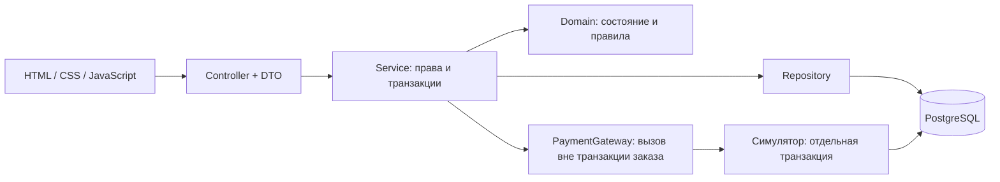
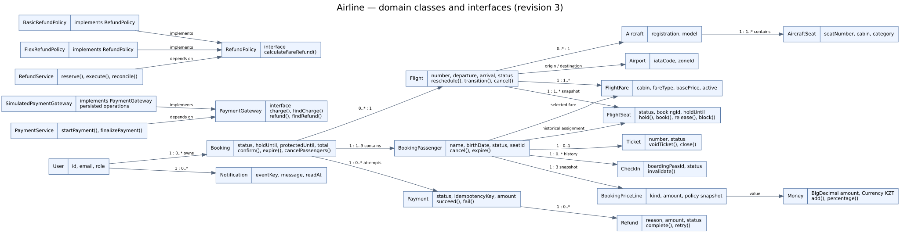
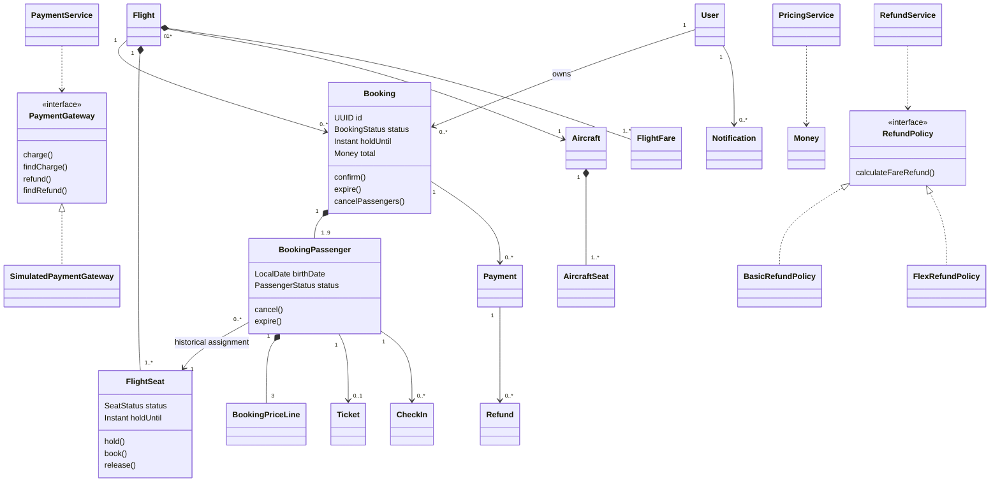
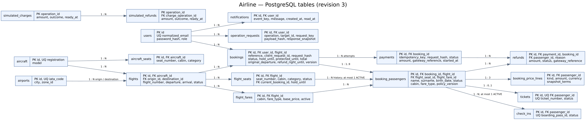
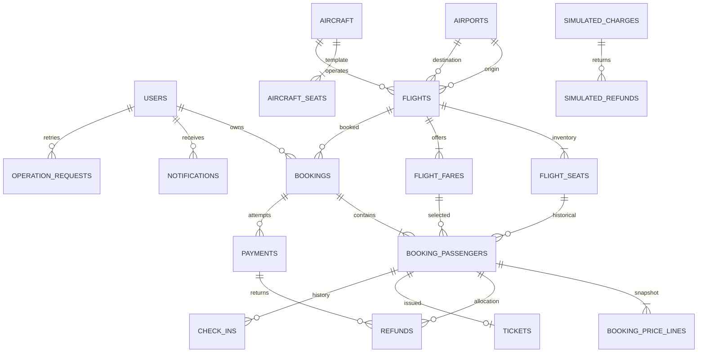
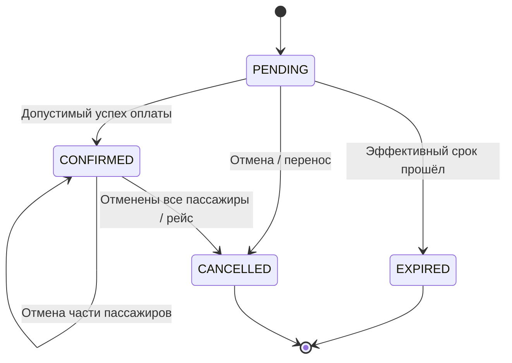

# Схемы проекта

Это проектные схемы редакции 3, не отражение уже созданной БД. Правила и ограничения: [SPECIFICATION.md](SPECIFICATION.md). SVG можно открыть без Mermaid. Исходники для редактирования: [classes.dot](diagrams/classes.dot), [er.dot](diagrams/er.dot). Схема показывает основные связи; полный набор UNIQUE/CHECK/FK перечислен в спецификации и будет закреплён SQL-миграциями.

## 1. Архитектура



## 2. Основные классы



Стрелка композиции означает владение составными частями. Билет относится к пассажиру, а заказ — к аккаунту покупателя; это разные связи. `Money` используется всеми денежными объектами. `RefundPolicy` содержит две учебные реализации, демонстрируя полиморфизм без искусственного наследования сущностей.



## 3. ER-схема



Все основные PK — UUID. Денежные поля numeric(12,2), время timestamptz, даты рождения date, enum хранится текстом с CHECK. Служебные timestamps и индексы запросов на схеме опущены для читаемости. Составные ключи раздела 16 спецификации обязательны, даже когда на рисунке связь показана одной стрелкой.



Симулятор связан с Payment/Refund через передаваемые глобальные UUID операции, а не каскадным FK к бизнес-таблицам. Он должен сохранять успех независимо от последующего сбоя финализации заказа.

## 4. Создание заказа

```mermaid
sequenceDiagram
    participant C as Клиент
    participant S as BookingService
    participant DB as PostgreSQL
    C->>S: flight, passengers, seats, clientRequestId
    S->>DB: BEGIN; lock User, Flight
    S->>DB: Повтор ключа? Сроки? Лимит? Цена? Все места?
    alt Все проверки пройдены
        S->>DB: Booking + passengers + price lines + HELD + notification
        S->>DB: COMMIT
        S-->>C: PENDING и holdUntil
    else Ошибка
        S->>DB: ROLLBACK
        S-->>C: Ошибка без частичного удержания
    end
```

## 5. Оплата и поздний результат

```mermaid
sequenceDiagram
    participant C as Клиент
    participant S as PaymentService
    participant DB as PostgreSQL
    participant G as PaymentGateway
    C->>S: Оплатить + Idempotency-Key
    S->>DB: TX A: lock Flight, Booking; проверить повтор, сроки
    S->>DB: PROCESSING + protectedUntil; COMMIT
    S->>G: charge(paymentId, amount), вне TX A
    G-->>S: Успех / отказ / неизвестно
    S->>DB: TX B: lock Flight, Booking, Payment; перечитать состояние
    alt Успех и заказ ещё допустим
        S->>DB: SUCCEEDED + CONFIRMED + BOOKED + tickets + notification
    else Успех после отмены/expiry
        S->>DB: SUCCEEDED + REQUESTED refund; заказ не восстанавливать
    else Нет определённого результата
        S->>DB: Оставить PROCESSING; позже lookup
    end
    S->>DB: COMMIT
    S-->>C: Текущее состояние
```

Определённый отказ даёт FAILED, снимает платёжное продление и проверяет исходный holdUntil. Возврат исполняется таким же трёхфазным способом: резерв в БД → вызов вне транзакции → фиксация/lookup результата. Финализация и фоновые задачи используют одинаковые правила, а не отдельную упрощённую логику.

## 6. Состояние заказа



Поздний успех оплаты не является переходом EXPIRED/CANCELLED → CONFIRMED. Это изменение Payment и создание Refund. Частичная отмена меняет пассажиров, даже когда статус Booking остаётся CONFIRMED.
